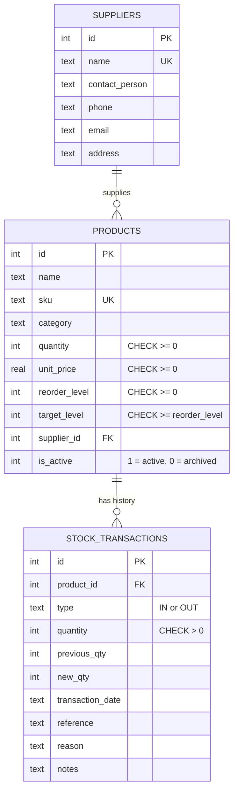

# Database Schema

SQLite database file: `instance/stockwise.db`. The full definition is in `schema.sql`.

## Entity relationship diagram

## Tables

### `suppliers`
Companies you buy from. `name` is unique (case-insensitive).

### `products`
| Column | Meaning |
|---|---|
| `sku` | Unique product code, stored in capitals, compared ignoring case |
| `quantity` | Units in stock now. Database rejects negative values |
| `reorder_level` | Alert when `quantity <= reorder_level` |
| `target_level` | Stock level to order back up to. Suggested order = `target_level − quantity` |
| `supplier_id` | Optional link to `suppliers`. `ON DELETE RESTRICT` |
| `is_active` | `0` = archived: hidden from lists/dashboard and cannot receive stock, but history is kept |

### `stock_transactions`
One row per stock-in or stock-out. **Rows are only ever inserted** by the application — never updated or deleted.

| Column | Meaning |
|---|---|
| `type` | `IN` (received) or `OUT` (sold/used/removed) |
| `quantity` | How many units moved (always positive) |
| `previous_qty` / `new_qty` | Stock before and after, saved at the time of the movement |
| `reference` | Optional PO/invoice number. New products with opening stock use `OPENING` |
| `reason` | Required for `OUT` (Sold, Used internally, Damaged, Expired, Returned to supplier, Lost, Other) |

## Integrity rules enforced by the database itself

| Rule | How |
|---|---|
| SKU is unique | `UNIQUE COLLATE NOCASE` on `products.sku` |
| Stock never negative | `CHECK (quantity >= 0)` |
| Prices / levels never negative; target ≥ reorder level | `CHECK` constraints |
| A transaction's numbers add up | `CHECK ((type='IN' AND new_qty = previous_qty + quantity) OR (type='OUT' AND new_qty = previous_qty - quantity))` |
| A product with history cannot be deleted | `FOREIGN KEY … ON DELETE RESTRICT` (with `PRAGMA foreign_keys = ON`) |
| Quantity and history change together | `BEGIN IMMEDIATE … COMMIT / ROLLBACK` in `services.record_movement` |

## Design decisions (and why)

- **Quantity is stored on `products` as well as in history.** This makes the dashboard fast and simple.
  The risk is the two disagreeing, so changes go through one function in one transaction, and
  `services.history_matches_stock()` can verify them (it is used by the tests and `seed_demo.py`).
- **No editing of transactions.** A mistake is corrected with a new, opposite transaction, which is how real stock ledgers work.
- **Archive instead of delete** keeps old reports and history meaningful.
- **Money as REAL (2 decimals)** keeps the project simple; a production accounting system would store whole cents as integers.
