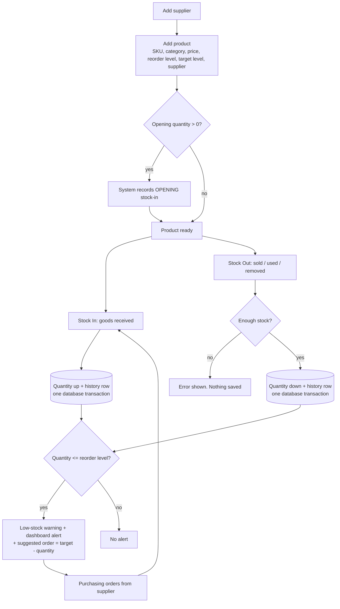
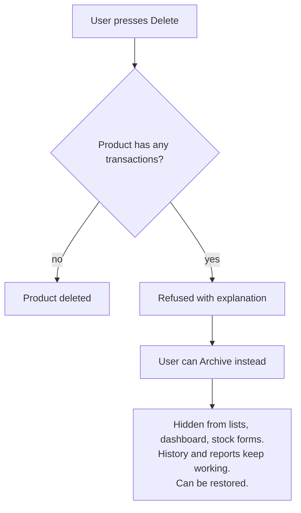

# Workflows

## 1. Overall stock lifecycle

## 2. Stock-out step by step

1. User opens **Stock Out**, picks a product (current stock is shown), enters quantity, date and reason.
2. The browser checks the basics (required fields, `max` quantity).
3. The server **validates again** (browser checks can be bypassed): whole number ≥ 1, valid non-future date, valid reason.
4. `BEGIN IMMEDIATE` locks the database for writing.
5. The server reads the current quantity. If `quantity > available` → `ROLLBACK`, show an error.
6. Otherwise it updates `products.quantity` and inserts a `stock_transactions` row (previous, new, reason, notes).
7. `COMMIT`. If anything failed in steps 5–6, `ROLLBACK` undoes everything.
8. The user sees a success message, and a warning if the new quantity is at or below the reorder level.

## 3. Handling a mistake
Transactions cannot be edited. If 10 units were received by mistake, record a Stock Out of 10 with reason
"Other" and a note. The history then shows both entries and the quantity is correct.

## 4. Deleting vs archiving a product

## 5. Reorder process
1. Dashboard / product list shows products at or below their reorder level (most urgent first).
2. Purchasing reads the suggested order quantity and supplier, and exports **Low-stock CSV** if needed.
3. Goods arrive → **Receive stock** records Stock In with the purchase-order reference.
4. The product leaves the alert list automatically once it is above its reorder level.
